<!-- ══════════════════════════ ANIMATED GLASS BANNER ══════════════════════════ -->

<!-- ══════════════════════════ ANIMATED TYPING ROLE ══════════════════════════ -->

 

<!-- ══════════════════════════ GLASS PILL BADGES ══════════════════════════ -->

 

<!-- ══════════════════════════ ABOUT ══════════════════════════ -->

### `✦ About Me ✦`

> I'm a passionate **Full Stack Developer** and **UI/UX Designer** from Tanzania,
> focused on building modern, scalable, and user-friendly digital products.
>
> I enjoy turning ideas into real-world applications — from mobile apps and business
> management systems to SaaS platforms and enterprise dashboards. My goal is to create
> software that solves practical problems while delivering an excellent user experience. ✨

 

<!-- ══════════════════════════ WHAT I DO ══════════════════════════ -->

### `✦ What I Do ✦`

<table align="center">
<tr>
<td>💻 Full Stack Web Development</td>
<td>📱 Cross-Platform Mobile Apps</td>
</tr>
<tr>
<td>🎨 UI/UX Design & Wireframing</td>
<td>🗄️ Database & Backend Development</td>
</tr>
<tr>
<td>☁️ Cloud Deployment & Architecture</td>
<td>🔗 REST API Development & Integration</td>
</tr>
</table>

 

<!-- ══════════════════════════ TECH STACK (glass tiles) ══════════════════════════ -->

### `✦ Tech Stack ✦`

**Frontend**

  

**Backend**

  

**Databases**

  

**Tools & Platforms**

  

 

<!-- ══════════════════════════ CURRENTLY LEARNING & INTERESTS ══════════════════════════ -->

### `✦ Currently Learning ✦`

### `✦ Interests ✦`

 

<!-- ══════════════════════════ PINNED / WORK ══════════════════════════ -->

### `✦ Featured Work ✦`

 

<!-- ══════════════════════════ STATS (transparent glass) ══════════════════════════ -->

### `✦ GitHub Stats ✦`

  

 

<!-- ══════════════════════════ TROPHIES ══════════════════════════ -->

### `✦ Trophies ✦`

 

<!-- ══════════════════════════ ACTIVITY GRAPH ══════════════════════════ -->

### `✦ Contribution Activity ✦`

 

<!-- ══════════════════════════ GAME ZONE ══════════════════════════ -->

### `✦ 🎮 Game Zone ✦`

<code>while (bugs.length) ship.fire();</code> — a self-playing arcade round, built as a pure animated SVG

  

  

🐍 My contributions, eaten live by a snake (refreshed every 12 hours)

 

<picture>
  <source media="(prefers-color-scheme: dark)" srcset="https://raw.githubusercontent.com/FrancHK/FrancHK/output/github-contribution-grid-snake-dark.svg" />
  <source media="(prefers-color-scheme: light)" srcset="https://raw.githubusercontent.com/FrancHK/FrancHK/output/github-contribution-grid-snake.svg" />
  
</picture>

 

<!-- ══════════════════════════ GOALS ══════════════════════════ -->

### `✦ Goals ✦`

> My mission is to build impactful software products that improve businesses and everyday
> life while continuously growing as a software engineer. I believe great software is not
> just about writing code — it's about solving problems, creating value, and delivering
> exceptional user experiences. 🎯

 

<!-- ══════════════════════════ CONNECT ══════════════════════════ -->

### `✦ Let's Connect ✦`

  

<i>⭐ Always learning. Always building. Always improving.</i>

  

